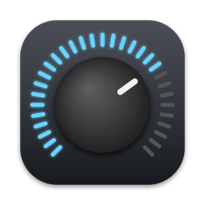
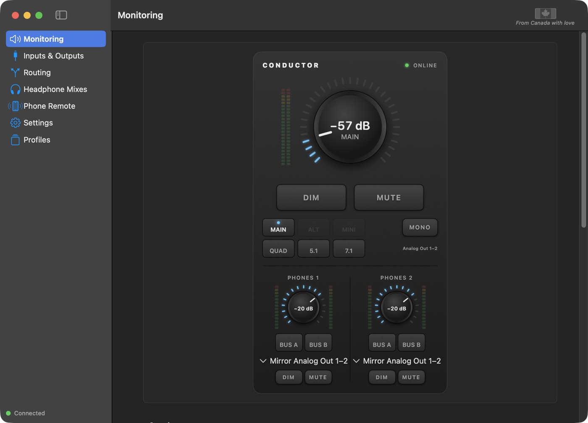
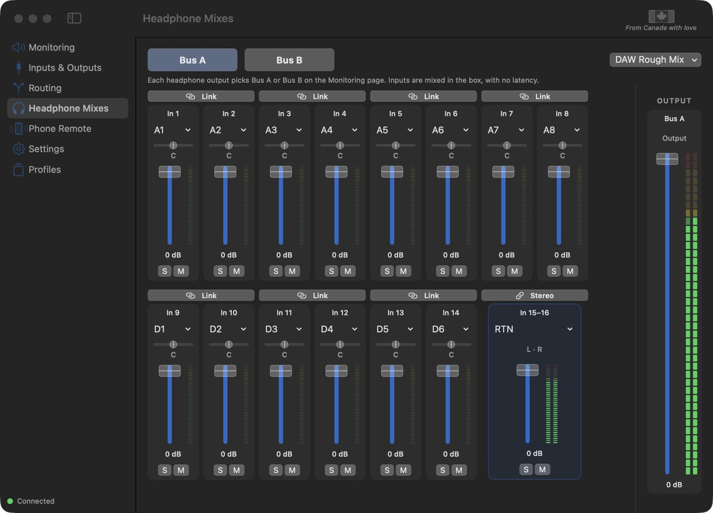
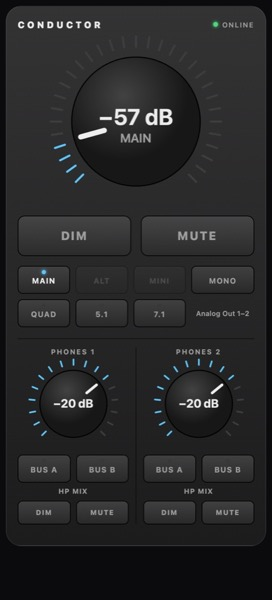

<h1 align="center">Conductor</h1>

Your multichannel interface, working on modern macOS, with a full control room on screen: 
monitoring, two headphone mixes, routing, profiles and a remote for your phone.

<a href="https://github.com/BigDumbRobot/Conductor/releases/latest/download/Conductor.dmg"><b>⬇ Download Conductor for Mac</b></a> 
macOS 14 Sonoma or later · Apple silicon and Intel · <a href="https://github.com/BigDumbRobot/Conductor/releases/latest/download/Conductor-Guide.pdf">Guide (PDF)</a>

## Install

1. **Download** Conductor (link above) and open `Conductor.dmg`.
2. **Double-click `Install Conductor.pkg`**, click Continue → Install, and enter your Mac password.
3. **Done.** Conductor opens by itself. Connect the interface by USB and switch it on: its front-panel **!** clears within a few seconds and the app says **Connected**.

> **macOS says it can't open the installer?** Click **Done**, open **System Settings → Privacy & Security**, scroll down to the message about Conductor and click **Open Anyway**. Then double-click the installer again.

The first time it runs, macOS asks two things. Allow both:
- **Record audio from other apps**, so the main and headphone meters show what your Mac plays.
- **Find devices on your local network**, so your phone can connect to Phone Remote.

## What you get

| | |
|---|---|
| **Monitoring** | A big monitor knob with DIM and MUTE, speaker sets (MAIN, ALT, MINI, QUAD, 5.1, 7.1), mono, and both headphone outputs. Also in the menu bar. |
| **Headphone Mixes** | Two zero-latency cue mixes with stereo-linked pairs and a one-click DAW rough mix. |
| **Phone Remote** | Scan a QR code and your phone becomes the monitor controller. |
| **Routing** | Choose what every output plays and what every recording channel carries. |
| **Profiles** | Save and recall your whole setup. Conductor also restores your settings if the interface forgets them after a power cycle. |

 &nbsp; 

## Update or remove

- **Update:** download the newest version and run its installer. Your settings and profiles stay.
- **Remove:** in Conductor, choose **Conductor → Uninstall Conductor…**

## Help

Everything is in the [Conductor Guide (PDF)](https://github.com/BigDumbRobot/Conductor/releases/latest/download/Conductor-Guide.pdf), also in the app under **Help → Conductor Guide**.
Problems or questions: [open an issue](https://github.com/BigDumbRobot/Conductor/issues) and attach `~/Library/Logs/Conductor.log`.

© 2026 Big Dumb Robot. All rights reserved. From Canada with love.
